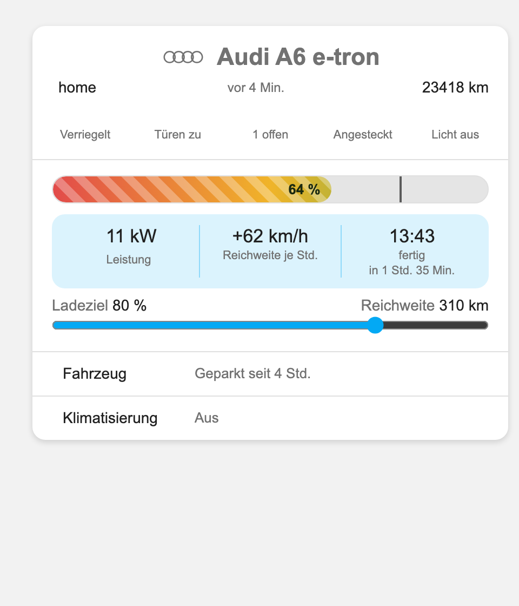
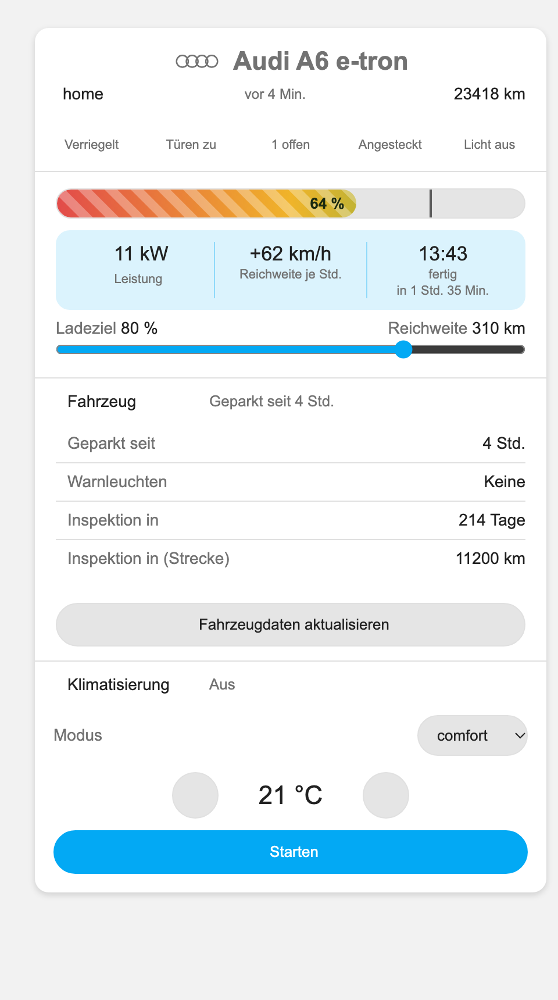
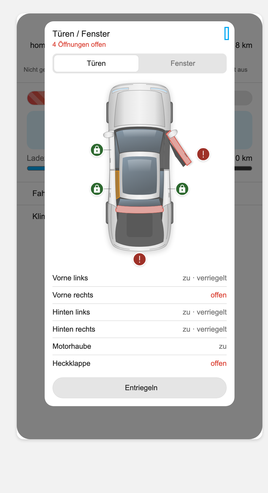
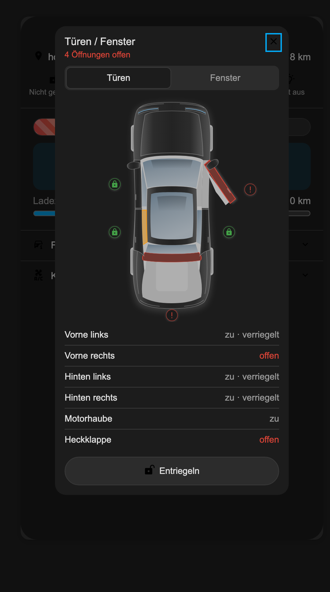

<h1 align="center">Audi Connect</h1>

<p align="center">
  Home Assistant integration for Audi Connect (myAudi) – vehicle status, remote actions and climatisation, fully configurable from the UI.
</p>

<p align="center">
  <a href="https://github.com/hacs/integration"></a>
  <a href="https://www.home-assistant.io/"></a>
  <a href="https://github.com/bertel2020/HA-audi_connect/releases"></a>
  <a href="https://github.com/bertel2020/HA-audi_connect/actions/workflows/validate.yml"></a>
  <a href="LICENSE"></a>
</p>

<p align="center">
  <a href="https://buymeacoffee.com/bertel2020"></a>
  <a href="https://ko-fi.com/bertel2020"></a>
  <a href="https://paypal.me/RobertoMartins"></a>
</p>

<p align="center"><em><a href="README.md">🇩🇪 Deutsche Version</a></em></p>

> [!IMPORTANT]
> **Authentication status.** Audi's legacy device and refresh flows are blocked in affected regions. The integration now uses the interactive myAudi Auth0/PKCE flow there. Existing entries that fail with `invalid assertion headers` will request reauthentication. See [#903](https://github.com/audiconnect/audi_connect_ha/issues/903) for background.

Due to API changes, **currently not all functionality is available**. Please open an [issue](https://github.com/bertel2020/HA-audi_connect/issues/new/choose) to report the topics you are missing.

> [!CAUTION]
> Excessive use of certain features in this integration may result in temporary or permanent suspension of your Audi Connect account. Please use responsibly. Use at your own risk.

The `audiconnect` component provides an integration with the Audi Connect cloud service. It adds presence detection, sensors such as range, mileage, and fuel level, and provides car actions such as locking/unlocking and setting the pre-heater.

This is a fork of [audiconnect/audi_connect_ha](https://github.com/audiconnect/audi_connect_ha). **Note:** Certain functions require special permissions from Audi, such as position update via GPS.

Credit for initial API discovery goes to the people at the ioBroker VW-Connect forum, who figured out how the API and the PIN hashing work. Some implementation credit goes to davidgiga1993 of the original [AudiAPI](https://github.com/davidgiga1993/AudiAPI) Python package, on which part of this code is loosely based. Full credit for the original integration goes to @arjenvrh.

## Installation

### Via HACS (recommended)

[](https://my.home-assistant.io/redirect/hacs_repository/?owner=bertel2020&repository=HA-audi_connect&category=integration)
[](https://my.home-assistant.io/redirect/config_flow_start/?domain=audiconnect)

1. Use the first button to open the Audi Connect repository in HACS.
2. Download **Audi Connect** and restart Home Assistant.
3. Use the second button to add the integration. Alternatively, open **Settings → Devices & services → Add integration → Audi Connect** in Home Assistant.

If the first button does not work, add `https://github.com/bertel2020/HA-audi_connect` in HACS under **Integrations → Custom repositories** as category **Integration**.

### Manual

Copy the directory `custom_components/audiconnect` to `/config/custom_components/audiconnect` and restart Home Assistant. Then add the integration (see **Configuration**).

## Configuration

Configuration is done through the Home Assistant UI.

To add the integration, go to **Settings ➤ Devices & Services ➤ Integrations**, click **➕ Add Integration**, and search for "Audi Connect".

For Auth0 regions, Home Assistant displays an Audi login link. Open it in a private browser window and sign in. Audi redirects to its registered `http://localhost:8080/myaudi-callback` URL; an unable-to-connect page is expected because no local server is required. Copy the complete URL from the browser address bar and paste it into the Home Assistant form. Home Assistant validates the OAuth state and exchanges the one-time code using PKCE.

Region, S-PIN and API level can be changed later through **Reconfigure** on the integration entry. If Audi rejects the stored login, Home Assistant starts the reauthentication flow. Reauthentication must use the same Audi account; with a different account Home Assistant aborts instead of re-pointing the entry.

### Configuration Variables

| Name            | Type     | Default | Description                                                                                                                                                                                                                          |
| --------------- | -------- | ------- | ------------------------------------------------------------------------------------------------------------------------------------------------------------------------------------------------------------------------------------ |
| `Username`      | `string` | –       | The username associated with your Audi Connect account. Used only in regions that retain password login.                                                                                                                             |
| `Password`      | `string` | –       | The password for your Audi Connect account. Used only in regions that retain password login.                                                                                                                                         |
| `S-PIN`         | `string` | –       | The S-PIN for your Audi Connect account to perform certain service actions.<br>(**Optional**)                                                                                                                                        |
| `Region`        | `string` | `DE`    | The region where your Audi Connect account is registered:<br>• `DE` – Europe<br>• `US` – United States<br>• `CA` – Canada<br>• `CN` – China                                                                                          |
| `Scan Interval` | `int`    | `15`    | Frequency (in minutes) to fetch status data from Audi Connect.<br>Minimum allowed is 15 minutes.<br>\* _Can be updated later via the CONFIGURE menu._                                                                                |
| `API Level`     | `int`    | `0`     | Determines the API structure used for service action calls:<br>• `0` – _Typically_ Gas vehicles (legacy format)<br>• `1` – _Typically_ e-tron (electric vehicles, newer format)<br>\* _Can be updated later via the CONFIGURE menu._ |

## Options

Find configuration options under **Settings ➤ Devices & Services ➤ Integrations ➤ Audi Connect ➤ Configure**:

| Name                                | Type   | Default | Description                                                                                                                                                                                                                                                                                                         |
| ----------------------------------- | ------ | ------- | ------------------------------------------------------------------------------------------------------------------------------------------------------------------------------------------------------------------------------------------------------------------------------------------------------------------- |
| `Refresh Vehicle Data After Action` | `bool` | `False` | Send a vehicle refresh command after every service action (e.g. climate, lock). This is typically not required as the vehicle will check in with the cloud on its own after a command. Each vehicle refresh counts against the API rate limit. To improve responsiveness, increase the Cloud Refresh Delay instead. |
| `Cloud Refresh Delay`               | `int`  | `5`     | Seconds to wait after a service action before refreshing cloud data. A longer delay gives the vehicle more time to report its updated state to the cloud.                                                                                                                                                           |
| `Scan Interval`                     | `int`  | `15`    | Defines polling frequency in minutes (minimum 15).                                                                                                                                                                                                                                                                  |
| `Excluded VINs`                     | `str`  | –       | Comma-separated VIN list to exclude from setup and updates.                                                                                                                                                                                                                                                         |
| `Quick start climate using car-stored settings` | `bool` | `False` | When the climate entity is switched on, send a bodyless CARIAD start request that uses the settings stored in the car. The temperature shown in Home Assistant is not sent. Optional workaround for newer cars. |
| `Enable experimental vehicle controls` | `bool` | `False` | Shows the window-heating start/stop buttons and the plug release switch. Verify real operation; HTTP 200 is not proof the vehicle acted. |

_Note: The integration will reload automatically upon clicking `Submit`, but a Home Assistant restart is suggested._

## Controls

Each vehicle's device page exposes its actions directly, so the common ones no longer need a service call. Availability depends on what the vehicle reports and, for the lock and engine controls, on an S-PIN being configured. Entities are grouped on the device page; the full list of sensors and binary sensors (range, mileage, charging, doors and windows, trips, service intervals, data freshness and more) follows what the car reports.

| Control                        | Type    | Replaces                                              |
| ------------------------------ | ------- | ----------------------------------------------------- |
| `Door lock`                    | Lock    | `execute_vehicle_action` with `lock` / `unlock`       |
| `Climatisation`                | Climate | `start_climate_control` / `stop_climatisation`        |
| `Preheater`                    | Switch  | `execute_vehicle_action` with `start_/stop_preheater` |
| `Global charge target`         | Number  | `set_target_soc`                                      |
| `Current location target`      | Number  | `set_location_charge_target` (no `profile_id`)        |
| `<Profile> charge target`      | Number  | `set_location_charge_target` with `profile_id`        |
| `Start engine` / `Stop engine` | Button  | `start_engine` / `stop_engine`                        |
| `Flash lights`                 | Button  | n/a, new                                              |
| `Charge mode`                  | Select  | `set_charge_mode`                                     |
| `Refresh vehicle data`         | Button  | `refresh_vehicle_data`                                |
| `Wake vehicle`                 | Button  | n/a, new; needs a reported wake-up capability         |
| `Honk and flash`               | Button  | n/a, new; disabled by default                         |
| `Climatisation ON/OFF`         | Switch  | n/a, Auth0 vehicles                                   |
| `Window heating`, `Climatisation at unlock`, seat zones | Switch | n/a, the car's stored climatisation settings |
| `Climatisation mode`           | Select  | `start_climate_control` with `climatisation_mode`     |
| `Start/Stop window heating (experimental)` | Button | `execute_vehicle_action` with `start_/stop_window_heating` |
| `Release plug after charging (experimental)` | Switch | n/a                                       |

### Feature status and API compatibility

Audi vehicles and regions do not all expose the same features. The integration
distinguishes between an Audi API request being accepted and the vehicle
actually performing an action. Check the vehicle and its subsequent reported
state before relying on remote commands in automations.

| Status                               | Control or capability                                               | Notes                                                                                                                                   |
| ------------------------------------ | ------------------------------------------------------------------- | --------------------------------------------------------------------------------------------------------------------------------------- |
| Standard, capability-dependent       | Door lock/unlock and flash lights                                   | Require the corresponding vehicle permission; verify the actual vehicle state                                                           |
| Standard on supported Auth0 vehicles | **Climatisation ON/OFF** switch                                     | Uses the climate settings already stored in the car and reads the car's reported state; does not replace the climate temperature entity |
| Legacy / model-dependent             | **Preheater** and the original **Climatisation** climate entity     | Retained for compatibility; older routes may be unavailable or rejected on newer Auth0-backed accounts                                  |
| Experimental, opt-in                 | Window-heating start/stop buttons and the plug release switch       | Disabled by default; enable _experimental vehicle controls_ under Configure, where a reported capability permits the action             |
| Capability-dependent                 | **Wake vehicle** and **Honk and flash** buttons                     | Wake vehicle needs a reported wake-up capability; Honk and flash is disabled in the entity registry by default                          |
| Service only                         | Start, timed start and stop of charging                             | Available through `execute_vehicle_action`; there is no entity for them (see below)                                                      |
| Model-dependent                      | Charge mode and target SOC changes                                  | Audi may accept an HTTP request while rejecting or not applying the setting                                                             |

_Legacy_ describes an older interface; it does not announce removal.
The integration keeps existing unique IDs and service calls where possible.
Availability and feature support must be checked per vehicle, not inferred from
one successful command or a capability list alone. A partial cloud response
may leave an entity **unavailable** instead of removing it.

**Lock/unlock:** Both directions now use one post-command refresh and
expose a `last_command_status` attribute: `request_failed`,
`accepted_unconfirmed`, `confirmed_by_readback`, or
`already_reported_in_requested_state`. An Audi gateway acknowledgement or
a delayed cloud state is not a confirmed physical door action, and neither
direction issues a blind retry.

**Remote engine:** Older non-Auth0 combustion vehicles without a capability
inventory retain the previous engine-button fallback. Explicit capability
denial, impaired support, known hybrid/electric types, and Q8 model vetoes
still apply. Auth0 vehicles require an explicitly reported permission.

**Charging settings:** On Auth0 vehicles a global target-SOC update refuses
to submit a potentially destructive `charging/settings` PUT if Audi returns
unknown settings. Known writable settings are preserved; timestamp metadata
is excluded. Additional writable keys require vehicle-specific evidence.

**Q8 climate:** On the tested Audi Q8 PHEV, climate ON/OFF works through the
separate modern Auth0/CARIAD command path using the car's stored settings.
Passing a temperature to the legacy climate interface has not worked on that
vehicle. This does not establish support across other Audi types or regions.
A future capability model should combine reported features with vehicle type,
API generation and verified model-specific behavior, without assuming that a
model name grants permission or that a missing capability is definitive proof
of absence.

**Wake / sleeping vehicle:** The `Wake vehicle` button (shown when the car reports a wake-up capability)
uses the Auth0/CARIAD `vehiclewakeuptrigger` route; a HTTP 2xx/204 acknowledgement
is **not proof** that the physical vehicle woke. Initial Q8 observations suggest
that a wake request may help recover delayed sleeping-vehicle and charging-status
readings, but this has not been validated as a general fix. Waking a parked
vehicle can also consume energy from its 12V and/or traction battery.
Therefore automatic polling must **never** wake the vehicle on each cycle,
and the current integration does not do so. Future work should separate
passive cloud refresh from active vehicle wake, use explicit user intent or
verified charging/session transitions as candidate triggers, apply per-vehicle
cooldowns and request/energy budgets, and confirm freshness after a bounded
delayed readback before presenting wake or charging status as current.
This work remains experimental pending measurements of status improvement,
actual wake response, and parked-vehicle battery impact.

`Refresh vehicle data` uses a separate route (`vehiclewakeup`) and waits up to 100 seconds for the car to answer. A car that does not answer in time is logged as a warning, not an error: it may be asleep or out of coverage.

### Charge targets

There are three kinds, because the car has three places to put the number:

- **Global charge target** writes `charging/settings`. It does not govern where a charge stops at a location (upstream #722), so it is the least useful of the three and is kept only because it is a real, separately-stored setting.
- **Current location charge target** writes whichever profile the car is parked in, resolved by the integration from `vehiclePositionedInProfileID`. Use it in automations that should apply wherever the car happens to be.
- **One number per location profile**, named after the profile ("Home charge target", "Work charge target"). These are enumerated from what the car reports, so a profile added or removed in the car appears or disappears after the next refresh. A profile deleted in the car leaves its control unavailable rather than showing a stale target.

`sensor.<vehicle>_active_charging_profile_name` says which profile is in force, so a dashboard can show the governing location beside the sliders. The per-profile controls are keyed on the profile id, not its name, so renaming a location in the myAudi app renames the control without breaking automations that reference it.

The service actions below still work and remain the way to reach the parameterised commands: `start_climate_control` (temperature, seat and glass heating, climatisation mode) and `start_auxiliary_heating` (duration) both take settings the vehicle does not report back, so they have no on-page control.

### Starting and stopping a charge

Neither is exposed as an entity, because neither has been consistently verified. Both stay reachable through `execute_vehicle_action` (`start_charger`, `stop_charger`, `start_timed_charger`); the car may reject them or they may have no physical effect.

Stopping is accepted by the API and confirmed by the car, and the charge continues. Sent twice from a settled state on a live vehicle, which carried on drawing 6.5 kW both times.

Starting is unproven. It appeared to work once, but the car had a target well above its state of charge at that moment and would have charged anyway; repeated later with the target below the state of charge, the command was accepted and nothing happened. There is no evidence separating "the button started the charge" from "the car was going to charge regardless".

Timed charging is not exposed either, for the same reason: it goes through the same command as start and stop.

Use `Target state of charge` instead. Raising it above the current level starts a charge and lowering it below stops one, which is the lever that behaved consistently in every direction under testing. The car's departure timers are the other reliable route, and are reported here but not yet writable.

Number and select entities (charge targets, `Charge mode`, `Climatisation mode`) show the value that was just sent until the car reports a different one, for at most 20 minutes. The car often confirms such values only after several minutes; without this assumption the control would jump straight back to the old value.

After a command the integration polls the cloud once. If the command itself already triggered a poll, no second one follows.

## Climatisation

The climate entity turns climatisation on and off and sets the target temperature. The car reports whether climatisation is running and in which mode (heating, cooling, ventilation), so the entity reflects the vehicle rather than what Home Assistant last asked for.

Two things it deliberately does not do. It has no current temperature, because the car reports the outdoor reading and not the cabin, and showing the outside temperature as a climate entity's current temperature would misstate what it measures. And it does not expose seat or glass heating, climatisation-at-unlock, or the comfort/economy mode: the vehicle never reports those back, so a control for them would only ever show what you last set. Use the `start_climate_control` service action for those.

The target temperature comes from the car, which reports it in its climatisation settings. Home Assistant only holds a value as a fallback for a vehicle that reports none, and for the moment between asking for a change and the car confirming it. The car stores half degrees and the control steps in half degrees too. With climatisation off, a new target is written to the car's settings without starting it; the car can take several minutes to report the new value, and until it does the control shows the value the car still holds.

The rest of the climatisation settings the car reports (window heating, climatisation at unlock, and the seat zones it has) appear as switches under configuration. They are written through the car's settings endpoint without starting climatisation, which the myAudi app does not offer: there, a heated seat can only be enabled while starting the air conditioning.

Each toggle sends the whole settings object back with one field changed, because the endpoint replaces rather than merges. Changing a seat therefore cannot clear the target temperature.

`start_auxiliary_heating` (duration) stays service-only for the same reason.

On Auth0 vehicles the **Climatisation ON/OFF** switch starts and stops climatisation with the settings stored in the car and follows the car's reported state. The option _Quick start climate using car-stored settings_ makes the climate entity do the same instead of sending the temperature shown in Home Assistant. The `Climatisation mode` select (comfort or economy) appears where the car reports a mode.

Which of these switches exist is up to the car: when it answers a setting with an explicit "not supported" (for example `supportsWindowHeatingEnabled: false` on the A6 e-tron), the integration does not create the switch. A missing answer keeps it. What your car reports is in the integration's diagnostics download under `capability_inventory`: `capability_ids` (every capability) and `supports_flags` (the answers for climatisation and charging profiles). The flags are read once when the integration starts; after a reload they show up in the diagnostics.

Climatisation timers in the car are reported by sensors (number of enabled timers, next timer in local time). They are created, switched and deleted with the timer service actions below.

## Why an entity sometimes disappears

Entities are created when the integration sets up, and until now that decision asked whether the value was present in the poll it happened to be holding. A partial or rate-limited poll therefore removed controls: on one vehicle a `429 Too Many Requests` took sixteen entities away, including a parking-position sensor for a car that plainly has parking position. They returned only after a reload.

The car reports what it can do, separately from what any one poll contains, and the integration now asks that list instead where a capability maps cleanly onto an entity. A missing value leaves the entity unavailable rather than deleting it.

Vehicles that do not report a capability list are unaffected and keep the previous behaviour.

### Flash and honk

`Flash` flashes the vehicle's lights for ten seconds. The car must have reported a position, because the API requires one; the control refuses rather than sending a request that would be rejected.

`Honk and flash` also sounds the horn. It is a separate button and disabled in the entity registry by default because it is loud. Both use the same endpoint, but `Flash` sends only the flash mode, so it can never sound the horn.

## Service Actions

### Audi Connect: Refresh Vehicle Data

`audiconnect.refresh_vehicle_data`

Normal updates retrieve data from the Audi Connect cloud service, and don't interact directly with the vehicle. _This_ service action triggers an update request from the vehicle itself. When data is retrieved successfully, Home Assistant is automatically updated. The service action requires the vehicle (device) as a parameter.

#### Parameters

- **`device_id`**: The Audi vehicle (device) to perform the action on.

> [!CAUTION]
> **This service action counts against your daily API rate limit.** Repeated use may exhaust your limit. Use sparingly and monitor your remaining API calls via the **"API Requests Remaining"** diagnostic sensor or **Settings → System → Repairs & System Information**.

> [!NOTE]
> The **"API Requests Remaining"** diagnostic sensor restores its last known value after a Home Assistant restart. Its `last_observed` attribute records when Audi last returned a `Vcf-Remaining-Calls` value. If `value_restored` is `true`, the displayed value was restored from the previous Home Assistant runtime and may no longer represent the current remaining allowance.

### Audi Connect: Refresh Cloud Data

`audiconnect.refresh_cloud_data`

_This_ service action triggers an update request from the cloud.

- Functionality: Updates data for all vehicles from the online source, mirroring the action performed at integration startup or during scheduled refresh intervals.
- Behavior: Does not force a vehicle-side data refresh. Consequently, if vehicles haven't recently pushed updates, retrieved data might be outdated.
- Note: This service action replicates the function of active polling without scheduling, offering a more granular control over data refresh moments.
- **IMPORTANT:** This service action has no built in usage limits. Excessive use may result in a temporary suspension of your account.

#### Parameters

- `none`

### Audi Connect: Execute Vehicle Action

`audiconnect.execute_vehicle_action`

This service action allows you to perform actions on your Audi vehicle, specified by the vehicle and the desired action.

#### Service Parameters

- **`device_id`**: The Audi vehicle (device) to perform the action on.
- **`action`**: The specific action to perform on the vehicle. Available actions include:
  - **`lock`**: Lock the vehicle.
  - **`unlock`**: Unlock the vehicle.
  - **`start_climatisation`**: Start the vehicle's climatisation system. (Legacy) -- Deprecated
  - **`stop_climatisation`**: Stop the vehicle's climatisation system.
  - **`start_charger`**: Start charging the vehicle.
  - **`start_timed_charger`**: Start the vehicle's charger with a timer.
  - **`stop_charger`**: Stop charging the vehicle.
  - **`start_preheater`**: Start the vehicle's preheater system. (Legacy) -- Deprecated
  - **`stop_preheater`**: Stop the vehicle's preheater system.
  - **`start_window_heating`**: Start heating the vehicle's windows.
  - **`stop_window_heating`**: Stop heating the vehicle's windows.

#### Usage Example

To lock a vehicle, use the following service call:

```yaml
service: audiconnect.execute_vehicle_action
data:
  device_id: 034986de941a1f824b3f06c0a1d9333f
  action: "lock"
```

#### Notes

- Certain service actions require the S-PIN to be set in the configuration.
- After a successful action, the integration waits for the configured **Cloud Refresh Delay** and then performs a cloud data refresh. If **Refresh Vehicle Data After Action** is enabled, a vehicle refresh is also sent before the delay.

### Audi Connect: Start Climate Control

`audiconnect.start_climate_control`

This service action allows you to start the climate control with options for temperature, glass surface heating, and auto seat comfort.

#### Parameters

- **`device_id`**: The Audi vehicle (device) to perform the action on.
- **`temp_f`** (_optional_): Desired temperature in Fahrenheit. Default is `70`.
- **`temp_c`** (_optional_): Desired temperature in Celsius. Default is `21`.
- **`glass_heating`** (_optional_): Enable (`True`) or disable (`False`) glass heating. Default is `False`.
- **`seat_fl`** (_optional_): Enable (`True`) or disable (`False`) the front-left seat heater. Default is `False`.
- **`seat_fr`** (_optional_): Enable (`True`) or disable (`False`) the front-right seat heater. Default is `False`.
- **`seat_rl`** (_optional_): Enable (`True`) or disable (`False`) the rear-left seat heater. Default is `False`.
- **`seat_rr`** (_optional_): Enable (`True`) or disable (`False`) the rear-right seat heater. Default is `False`.
- **`climatisation_at_unlock`** (_optional_): Let climatisation continue when the vehicle is unlocked.
- **`climatisation_mode`** (_optional_): `comfort` (default) or `economy`.

#### Usage Example

To start the climate control with a temperature of 72°F, enable glass heating, and activate both front seat heaters, use the following service call:

```yaml
service: audiconnect.start_climate_control
data:
  device_id: 034986de941a1f824b3f06c0a1d9333f
  temp_f: 72
  glass_heating: True
  seat_fl: True
  seat_fr: True
```

#### Notes

- The `temp_f` and `temp_c` parameters are mutually exclusive. If both are provided, `temp_f` takes precedence.
- If neither `temp_f` nor `temp_c` is provided, the system defaults to 70°F or 21°C.
- After a successful action, the integration waits for the configured **Cloud Refresh Delay** and then performs a cloud data refresh. If **Refresh Vehicle Data After Action** is enabled, a vehicle refresh is also sent before the delay.

### Audi Connect: Start Auxiliary Heating

`audiconnect.start_auxiliary_heating`

This service action allows you to start auxiliary heating the vehicle, with option for duration.

#### Parameters

- **`device_id`**: The Audi vehicle (device) to perform the action on.
- **`duration`** (_optional_): The number of minutes the auxiliary heater should run before turning off. Default is `20` minutes if not provided.

#### Usage Example

To start the auxiliary heater for 40 minutes, use the following service call action:

```yaml
service: audiconnect.start_auxiliary_heating
data:
  device_id: 034986de941a1f824b3f06c0a1d9333f
  duration: 40
```

#### Notes

- Requires the S-PIN to be set in the configuration.
- After a successful action, the integration waits for the configured **Cloud Refresh Delay** and then performs a cloud data refresh. If **Refresh Vehicle Data After Action** is enabled, a vehicle refresh is also sent before the delay.

### Audi Connect: Set Target State of Charge

`audiconnect.set_target_soc`

Sets the global target state of charge (20-100 %, steps of 5). See **Charge targets** for what this value does and does not govern.

- **`device_id`**: The Audi vehicle.
- **`target_soc`**: Target charge level in percent.

### Audi Connect: Set Location Charge Target

`audiconnect.set_location_charge_target`

Sets the target state of charge of a location profile (20-100 %, steps of 5). This persistent setting is what governs where a charge stops at that location.

- **`device_id`**: The Audi vehicle.
- **`profile_id`** (_optional_): The profile to change. Leave empty to change the profile the car is currently parked in.
- **`target_soc`**: Target charge level for this location.

### Audi Connect: Set Charge Mode

`audiconnect.set_charge_mode`

Sets the charge mode preference. It does not start or stop a charge in progress.

- **`device_id`**: The Audi vehicle.
- **`charge_mode`**: `manual` charges whenever plugged in; `timer` charges only during the car's scheduled times.

### Audi Connect: Start Engine / Stop Engine

`audiconnect.start_engine`, `audiconnect.stop_engine`

Remotely start or stop the engine. Starting requires the S-PIN. Subject to the capability rules under **Feature status and API compatibility**.

- **`device_id`**: The Audi vehicle.

### Audi Connect: Climatisation timers

`audiconnect.create_climatisation_timer`, `audiconnect.set_climatisation_timer_enabled`, `audiconnect.delete_climatisation_timer`

Manage the car's climatisation timers. Times are in the car's local time. The timer number is shown in the attributes of the climate timer sensors.

- **`device_id`**: The Audi vehicle.
- Create: **`time`** (for example `07:30`), **`days`** (a single timer takes exactly one day), **`repeat`** (every week, default on), **`enabled`** (default on).
- Switch: **`timer_id`**, **`enabled`**.
- Delete: **`timer_id`**.

### Diagnostics

The following service actions are for troubleshooting. Use them only when investigating missing data, because they count against the API limit.

- `audiconnect.probe_api` sends a read-only request (selectivestatus `jobs`, a `path` below the vehicle URL, or a fixed `graphql` query) and returns the redacted answer.
- `audiconnect.probe_api_paths` checks eight known read-only endpoints (`extended` adds four experimental ones). The result appears in the next **Download diagnostics** export. Running it again with a different mode within 15 minutes is rejected.
- `audiconnect.test_climatisation_write` is experimental. It writes one climatisation setting with a chosen request body variant (`app_dto` is the default; `app_full` sends all twelve fields of the app's request) and **changes the setting stored in the car**.

The diagnostic sensors `Vehicle data freshness`, `Vehicle data age`, `Cloud last successful poll` and `API Requests Remaining` show how current the data is. For detailed logs set `custom_components.audiconnect: debug` under `logger:` in `configuration.yaml`.

## Dashboard Card

<p align="center">
  
  
  
</p>

<p align="center">
  
  
</p>

<p align="center"><em>Sample data, shown in Home Assistant's default theme. Top: the card, the expanded sections and the doors popup. Bottom: the same in dark mode and the windows tab.</em></p>

The integration ships its own dashboard card, `audi-connect-card`. There is nothing to install and no YAML to write: it is loaded automatically once the integration is set up.

1. Open a dashboard, choose **Edit** and **Add card**.
2. Pick **Audi Connect**.
3. Choose your vehicle in the card editor. A photo is optional: upload one, or pick a picture from your `www` folder (it is served as `/local/...`).

What it shows:

- Tap the title or the photo to open the integration; hold it to refresh the vehicle data.
- Position, mileage and how old the data is, then one row of status icons for lock, doors, windows, plug, lights and warnings. Tapping doors or windows opens a top view with every door and window; the lock button in that pop-up locks or unlocks after a confirmation.
- The state of charge as a bar, with the charge target as a marker (and a slider to change it). While charging the bar is animated and a band shows the power, the range gained per hour and when it will be done. A plugged-in car that is waiting, a reached charge target or a charging error is shown as a short note below the bar.
- Last trip and long-term trip, each collapsed until you open it.
- Electric range, days to the next inspection and how long the car has been parked.
- Climatisation with mode, temperature, seat heating, start and stop.

Entities are found through the vehicle's device and each entity's translation key, so they are picked up whatever you named them. Parts the car does not have are left out.

The card is available in English and German and follows your Home Assistant language. If it does not show up in the card list, reload the browser once so the frontend loads it.

## Contributing

See [CONTRIBUTING.md](CONTRIBUTING.md).

## Disclaimer

This is an independent, community-developed integration. It is not affiliated with, endorsed or supported by Audi, Volkswagen Group or CARIAD. The API was reverse-engineered and can change or stop working at any time. It can send commands to a real vehicle. It is provided **"as is", without warranty of any kind** (see [LICENSE](LICENSE)); use it at your own risk.

"Audi", "myAudi" and all other product and company names mentioned in this repository are trademarks or registered trademarks of their respective owners. They are used only to describe which service this integration works with. "Home Assistant" is a trademark of the Open Home Foundation.

## Copyright & License

Copyright © 2019 Arjen van Rhijn (@arjenvrh), modifications © 2026 bertel2020. Licensed under the [MIT License](LICENSE).
