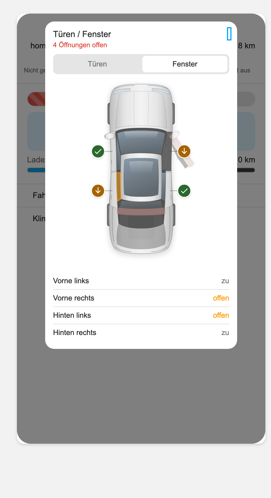

<h1 align="center">Audi Connect</h1>

  Home Assistant integration for Audi Connect (myAudi) – vehicle status, remote actions and climatisation, fully configurable from the UI.

  
  
  
  
  

  
  
  

<em><a href="README.md">🇩🇪 Deutsche Version</a></em>

> [!IMPORTANT]
> **Authentication status.** Audi's legacy device and refresh flows are blocked in affected regions. The integration now uses the interactive myAudi Auth0/PKCE flow there. Existing entries that fail with `invalid assertion headers` will request reauthentication. See [#903](https://github.com/audiconnect/audi_connect_ha/issues/903) for background.

Due to API changes, **currently not all functionality is available**. Please open an [issue](https://github.com/bertel2020/HA-audi_connect/issues/new/choose) to report the topics you are missing.

> [!CAUTION]
> Excessive use of certain features in this integration may result in temporary or permanent suspension of your Audi Connect account. Please use responsibly. Use at your own risk.

The `ha_audi_connect` component provides an integration with the Audi Connect cloud service. It adds presence detection, sensors such as range, mileage, and fuel level, and provides car actions such as locking/unlocking and setting the pre-heater.

This is a fork of [audiconnect/audi_connect_ha](https://github.com/audiconnect/audi_connect_ha). **Note:** Certain functions require special permissions from Audi, such as position update via GPS.

Credit for initial API discovery goes to the people at the ioBroker VW-Connect forum, who figured out how the API and the PIN hashing work. Some implementation credit goes to davidgiga1993 of the original [AudiAPI](https://github.com/davidgiga1993/AudiAPI) Python package, on which part of this code is loosely based. Full credit for the original integration goes to @arjenvrh.

## Installation

### Via HACS (recommended)

1. Use the first button to open the Audi Connect repository in HACS.
2. Download **Audi Connect** and restart Home Assistant.
3. Use the second button to add the integration. Alternatively, open **Settings → Devices & services → Add integration → Audi Connect** in Home Assistant.

If the first button does not work, add `https://github.com/bertel2020/HA-audi_connect` in HACS under **Integrations → Custom repositories** as category **Integration**.

### Manual

Copy the directory `custom_components/ha_audi_connect` to `/config/custom_components/ha_audi_connect` and restart Home Assistant. Then add the integration (see **Configuration**).

### Moving from the `audiconnect` domain

The integration is now called `ha_audi_connect` in Home Assistant (directory `custom_components/ha_audi_connect`), so it no longer overlaps with the upstream integration `audiconnect`. Home Assistant treats this as a new integration. To keep history and entity IDs:

1. Remove the existing integration under **Settings → Devices & services**. Its entities and the device leave the registry; the history in the recorder stays.
2. Delete the old directory `custom_components/audiconnect` (with HACS, remove the old installation) and install the new version.
3. Restart Home Assistant and set up **Audi Connect** again. The entities are created with the same IDs as before as long as the vehicle title stays the same, and continue history and statistics.

Sign-in, S-PIN and options have to be entered again, and customisations of entities (names, areas, visibility) are lost. Automations and scripts that use `audiconnect.*` services must be changed to `ha_audi_connect.*`.

## Configuration

Configuration is done through the Home Assistant UI.

To add the integration, go to **Settings ➤ Devices & Services ➤ Integrations**, click **➕ Add Integration**, and search for "Audi Connect".

For Auth0 regions, Home Assistant displays an Audi login link. Open it in a private browser window and sign in. Audi redirects to its registered `http://localhost:8080/myaudi-callback` URL; an unable-to-connect page is expected because no local server is required. Copy the complete URL from the browser address bar and paste it into the Home Assistant form. Home Assistant validates the OAuth state and exchanges the one-time code using PKCE.

Region, S-PIN and API level can be changed later through **Reconfigure** on the integration entry. If Audi rejects the stored login, Home Assistant starts the reauthentication flow. Reauthentication must use the same Audi account; with a different account Home Assistant aborts instead of re-pointing the entry.

### Configuration Variables

| Name            | Type     | Default | Description                                                                                                                                                                                                                          |
| --------------- | -------- | ------- | ------------------------------------------------------------------------------------------------------------------------------------------------------------------------------------------------------------------------------------ |
| `Username`      | `string` | –       | The username associated with your Audi Connect account. Used only in regions that retain password login.                                                                                                                             |
| `Password`      | `string` | –       | The password for your Audi Connect account. Used only in regions that retain password login.                                                                                                                                         |
| `S-PIN`         | `string` | –       | The S-PIN for your Audi Connect account to perform certain service actions. (**Optional**)                                                                                                                                        |
| `Region`        | `string` | `DE`    | The region where your Audi Connect account is registered: • `DE` – Europe • `US` – United States • `CA` – Canada • `CN` – China                                                                                          |
| `Scan Interval` | `int`    | `15`    | Frequency (in minutes) to fetch status data from Audi Connect. Minimum allowed is 15 minutes. \* _Can be updated later via the CONFIGURE menu._                                                                                |
| `API Level`     | `int`    | `0`     | Determines the API structure used for service action calls: • `0` – _Typically_ Gas vehicles (legacy format) • `1` – _Typically_ e-tron (electric vehicles, newer format) \* _Can be updated later via the CONFIGURE menu._ |

## Options

Find configuration options under **Settings ➤ Devices & Services ➤ Integrations ➤ Audi Connect ➤ Configure**:

| Name                                | Type   | Default | Description                                                                                                                                                                                                                                                                                                         |
| ----------------------------------- | ------ | ------- | ------------------------------------------------------------------------------------------------------------------------------------------------------------------------------------------------------------------------------------------------------------------------------------------------------------------- |
| `Refresh Vehicle Data After Action` | `bool` | `False` | Send a vehicle refresh command after every service action (e.g. climate, lock). This is typically not required as the vehicle will check in with the cloud on its own after a command. Each vehicle refresh counts against the API rate limit. To improve responsiveness, increase the Cloud Refresh Delay instead. |
| `Cloud Refresh Delay`               | `int`  | `5`     | Seconds to wait after a service action before refreshing cloud data. A longer delay gives the vehicle more time to report its updated state to the cloud.                                                                                                                                                           |
| `Scan Interval`                     | `int`  | `15`    | Defines polling frequency in minutes (minimum 15).                                                                                                                                                                                                                                                                  |
| `Excluded VINs`                     | `str`  | –       | Comma-separated VIN list to exclude from setup and updates.                                                                                                                                                                                                                                                         |
| `Quick start climate using car-stored settings` | `bool` | `False` | When the climate entity is switched on, send a bodyless CARIAD start request that uses the settings stored in the car. The temperature shown in Home Assistant is not sent. Optional workaround for newer cars. |
| `Enable experimental vehicle controls` | `bool` | `False` | Shows the window-heating and charging start/stop buttons (both disabled by default) and the plug release switch. Verify real operation; HTTP 200 is not proof the vehicle acted. |
| `Log raw API responses (debug)` | `bool` | `False` | For troubleshooting only: writes each vehicle reply from Audi whole into the debug log. The VIN, positions, user ID, PINs and tokens are masked, and sign-in and token routes are never logged. Needs the integration's debug logging to be on (see [Diagnostics](guide/user-guide.en.md#diagnostics)). Check a log before you share it. |
| `Also log VIN and position unredacted` | `bool` | `False` | Only with the option above: leaves the VIN, the position and the user ID in the logged replies. |

_Note: The integration will reload automatically upon clicking `Submit`, but a Home Assistant restart is suggested._

## Further reading

- **[User guide](guide/user-guide.en.md):** controls, charge targets, climatisation, service actions, diagnostics and repair hints.
- **[API notes](guide/api-notes.en.md):** feature status per vehicle, waking the car and why an entity sometimes disappears.

## Dashboard Card

  
  
  

  
  

<em>Sample data, shown in Home Assistant's default theme. Top: the card, the expanded sections and the doors popup. Bottom: the same in dark mode and the windows tab.</em>

The integration ships its own dashboard card, `audi-connect-card`. There is nothing to install and no YAML to write: it is loaded automatically once the integration is set up.

1. Open a dashboard, choose **Edit** and **Add card**.
2. Pick **Audi Connect**.
3. Choose your vehicle in the card editor. A photo is optional: upload one, or pick a picture from your `www` folder (it is served as `/local/...`).

What it shows:

- Tap the title or the photo to open the integration; hold it to refresh the vehicle data.
- Position, mileage and how old the data is, then one row of status icons for lock, doors, windows, plug, lights and warnings. When no door or window sensor reports a value, it says "unknown" instead of "closed". Tapping doors or windows opens a top view with every door and window; the lock button in that pop-up locks or unlocks after a confirmation.
- The state of charge as a bar, with the charge target as a marker (and a slider to change it). While charging the bar is animated and a band shows the power, the range gained per hour and when it will be done (with the day, for example "done tomorrow", when that is after midnight). A plugged-in car that is waiting, a reached charge target or a charging error is shown as a short note below the bar.
- Last trip and long-term trip, each collapsed until you open it. The last trip's row says how long ago it was ("10 h ago") when the car reports the time (sensor `Last trip ended`).
- The Vehicle section, collapsed until you open it: how long the car has been parked, parking brake, warning lights, security status, outside temperature, inspection and oil change (days and distance), charging type and maximum charge current, as far as the car reports them. The refresh-vehicle-data button is there too. Which rows appear is chosen in the card editor under **Vehicle details shown** (`stats_rows`); only what the car reports is offered. With no choice, or with every row ticked, all of them appear, including rows a car gains later.
- Climatisation with mode, temperature, start and stop. The zone buttons (seat heating) are hidden by default, because it is not confirmed what the zones control on a given car. In the card editor the front buttons (front left and right) and the rear buttons can be turned on separately: **Show front seat/zone buttons** and **Show rear seat/zone buttons**. Both are indented as sub-items under **Show climate**, only appear when the car reports those zones, and are greyed out while the climate section is hidden. The earlier option `show_seats` still works and means the front buttons.
- When an action fails (for example because Audi does not answer), a red note names the action (for example "Start climate failed") and shows Home Assistant's message at the top of the card (inside the doors popup while that is open) for a few seconds. Home Assistant then shows no second message.

The card editor also switches the Audi logo, trips, climate and the vehicle details on and off. **Show last trip** (`show_trip_last`) and **Show long-term trip** (`show_trip_long`) are separate switches; the older option `show_trips` still switches both.

Entities are found through the vehicle's device and each entity's translation key, so they are picked up whatever you named them. Parts the car does not have are left out.

The card is available in English and German and follows your Home Assistant language. If it does not show up in the card list, reload the browser once so the frontend loads it.

## Contributing

See [CONTRIBUTING.md](CONTRIBUTING.md).

## Changelog

See [CHANGELOG.en.md](CHANGELOG.en.md).

## Disclaimer

This is an independent, community-developed integration. It is not affiliated with, endorsed or supported by Audi, Volkswagen Group or CARIAD. The API was reverse-engineered and can change or stop working at any time. It can send commands to a real vehicle. It is provided **"as is", without warranty of any kind** (see [LICENSE](LICENSE)); use it at your own risk.

"Audi", "myAudi" and all other product and company names mentioned in this repository are trademarks or registered trademarks of their respective owners. They are used only to describe which service this integration works with. "Home Assistant" is a trademark of the Open Home Foundation.

## Copyright & License

Copyright © 2019 Arjen van Rhijn (@arjenvrh), modifications © 2026 bertel2020. Licensed under the [MIT License](LICENSE).
