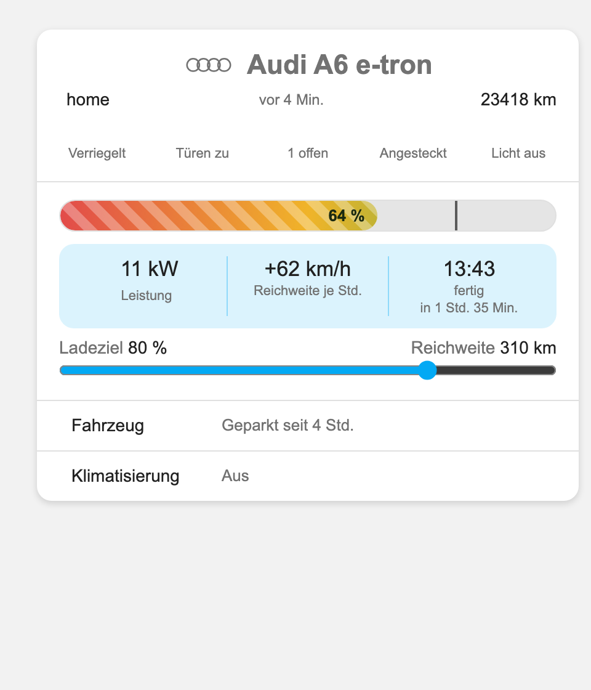
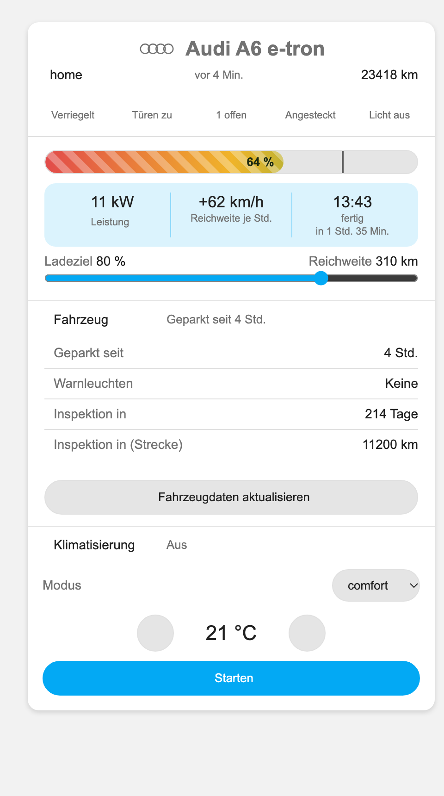
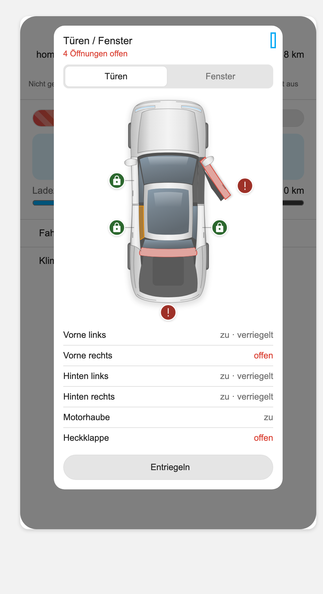
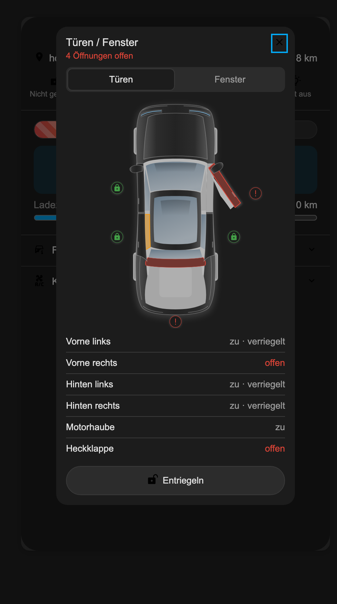
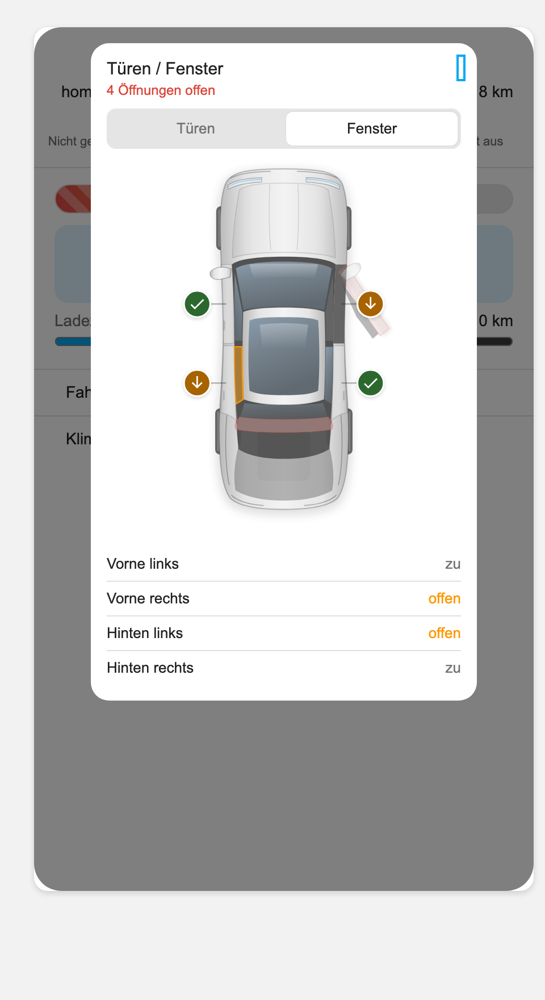

  <picture>
    <source media="(prefers-color-scheme: dark)" srcset="custom_components/ha_audi_connect/brand/dark_logo@2x.png">
    
  </picture>

  Home-Assistant-Integration für Audi Connect (myAudi) – Fahrzeugstatus, Fernsteuerung und Klimatisierung, komplett über die Oberfläche einrichtbar.

  
  
  
  
  

  
  
  

<em><a href="README.en.md">🇬🇧 English version</a></em>

> [!IMPORTANT]
> **Anmeldestatus.** Audis alte Geräte- und Refresh-Anmeldewege sind in betroffenen Regionen gesperrt. Die Integration nutzt dort den interaktiven myAudi-Auth0/PKCE-Ablauf. Bestehende Einträge, die mit `invalid assertion headers` fehlschlagen, fordern eine erneute Anmeldung an. Hintergrund: [#903](https://github.com/audiconnect/audi_connect_ha/issues/903).

Wegen API-Änderungen ist **derzeit nicht der gesamte Funktionsumfang verfügbar**. Fehlt dir etwas, eröffne bitte ein [Issue](https://github.com/bertel2020/HA-audi_connect/issues/new/choose).

> [!CAUTION]
> Übermäßige Nutzung einzelner Funktionen kann dazu führen, dass dein Audi-Connect-Konto vorübergehend oder dauerhaft gesperrt wird. Nutze die Integration verantwortungsvoll und auf eigenes Risiko.

Die Komponente `ha_audi_connect` bindet den Audi-Connect-Cloud-Dienst an Home Assistant an. Sie liefert Anwesenheitserkennung, Sensoren wie Reichweite, Kilometerstand und Tankfüllstand und bietet Fahrzeugaktionen wie Ver- und Entriegeln oder die Standheizung.

Dies ist ein Fork von [audiconnect/audi_connect_ha](https://github.com/audiconnect/audi_connect_ha). **Hinweis:** Einzelne Funktionen, etwa die Positionsaktualisierung per GPS, benötigen besondere Berechtigungen von Audi.

Dank für die erste Erkundung der API geht an die Leute aus dem ioBroker-VW-Connect-Forum, die herausgefunden haben, wie die API und das PIN-Hashing funktionieren. Teile des Codes basieren lose auf dem Python-Paket [AudiAPI](https://github.com/davidgiga1993/AudiAPI) von davidgiga1993. Der Dank für die ursprüngliche Integration gilt @arjenvrh.

## Installation

### Über HACS (empfohlen)

1. Über den ersten Button das Audi-Connect-Repository in HACS öffnen.
2. **Audi Connect** herunterladen und Home Assistant neu starten.
3. Über den zweiten Button die Integration hinzufügen. Alternativ in Home
   Assistant **Einstellungen → Geräte & Dienste → Integration hinzufügen →
   Audi Connect** öffnen.

Falls der erste Button nicht funktioniert, in HACS unter **Integrationen →
Benutzerdefinierte Repositories** `https://github.com/bertel2020/HA-audi_connect`
als Kategorie **Integration** eintragen.

### Manuell

Das Verzeichnis `custom_components/ha_audi_connect` nach
`/config/custom_components/ha_audi_connect` kopieren und Home Assistant neu
starten. Danach die Integration hinzufügen (siehe **Einrichtung**).

### Umstieg von der Domain `audiconnect`

Die Integration heißt in Home Assistant jetzt `ha_audi_connect` (Verzeichnis `custom_components/ha_audi_connect`), damit sie sich nicht mehr mit der Upstream-Integration `audiconnect` überschneidet. Home Assistant behandelt das als neue Integration. So behältst du Verlauf und Entity-IDs:

1. Die bisherige Integration unter **Einstellungen → Geräte & Dienste** entfernen. Dabei verschwinden Entitäten und Gerät aus der Registry, der Verlauf im Recorder bleibt.
2. Das alte Verzeichnis `custom_components/audiconnect` löschen (bei HACS die alte Installation entfernen) und die neue Version installieren.
3. Home Assistant neu starten und **Audi Connect** neu einrichten. Die Entitäten entstehen mit denselben IDs wie vorher, solange der Fahrzeugtitel gleich bleibt, und setzen Verlauf und Statistik fort.

Neu einzurichten sind Anmeldung, S-PIN und Optionen, und Anpassungen an Entitäten (Namen, Bereiche, Sichtbarkeit) gehen verloren. Automationen und Skripte mit Diensten `audiconnect.*` müssen auf `ha_audi_connect.*` umgestellt werden.

## Einrichtung

Die Einrichtung erfolgt über die Home-Assistant-Oberfläche.

Unter **Einstellungen ➤ Geräte & Dienste ➤ Integrationen** auf **➕ Integration hinzufügen** klicken und nach „Audi Connect“ suchen.

In Auth0-Regionen zeigt Home Assistant einen Audi-Anmeldelink. Öffne ihn in einem privaten Browserfenster und melde dich an. Audi leitet dann auf die registrierte Adresse `http://localhost:8080/myaudi-callback` weiter; eine Seite „Verbindung nicht möglich“ ist erwartet, weil kein lokaler Server nötig ist. Kopiere die vollständige URL aus der Adressleiste und füge sie in das Formular von Home Assistant ein. Home Assistant prüft den OAuth-State und tauscht den einmaligen Code per PKCE ein.

Region, S-PIN und API-Level lassen sich später über **Neu konfigurieren** am Integrationseintrag ändern. Lehnt Audi die gespeicherte Anmeldung ab, startet Home Assistant die erneute Anmeldung. Beim erneuten Anmelden muss es dasselbe Audi-Konto sein; mit einem anderen Konto bricht Home Assistant ab, statt den Eintrag umzuhängen.

### Angaben bei der Einrichtung

Das Formular erklärt jedes Feld selbst. Kurz:

- **Region:** wo dein Audi-Connect-Konto registriert ist (DE Europa, US USA, CA Kanada, CN China).
- **S-PIN:** optional, nur für Aktionen wie Ver- und Entriegeln oder Motorstart.
- **Abfrageintervall:** Minuten zwischen zwei Cloud-Abfragen, mindestens 15.
- **API-Level:** das Anfrageformat deines Autos, _Verbrenner / ältere Modelle_ oder _e-tron / neuere Modelle_.
- **Benutzername und Passwort:** nur in Regionen mit Passwort-Anmeldung. In den anderen meldest du dich im Browser an (siehe oben).

Region, S-PIN und API-Level lassen sich später über **Neu konfigurieren** ändern, das Abfrageintervall unter **Konfigurieren**.

## Optionen

Die Optionen findest du unter **Einstellungen ➤ Geräte & Dienste ➤ Integrationen ➤ Audi Connect ➤ Konfigurieren**:

| Name                                | Typ    | Standard | Beschreibung                                                                                                                                                                                                                                                                                                                       |
| ----------------------------------- | ------ | -------- | ---------------------------------------------------------------------------------------------------------------------------------------------------------------------------------------------------------------------------------------------------------------------------------------------------------------------------------- |
| `Refresh Vehicle Data After Action` | `bool` | `False`  | Schickt nach jeder Service-Aktion (z. B. Klima, Verriegelung) einen Fahrzeug-Refresh. Das ist meist nicht nötig, weil sich das Fahrzeug nach einem Befehl selbst in der Cloud meldet. Jeder Fahrzeug-Refresh zählt gegen das API-Limit. Für mehr Reaktionsgeschwindigkeit lieber die Cloud-Refresh-Verzögerung erhöhen.            |
| `Cloud Refresh Delay`               | `int`  | `5`      | Sekunden, die nach einer Service-Aktion bis zur Cloud-Abfrage gewartet wird. Eine längere Verzögerung gibt dem Fahrzeug mehr Zeit, seinen neuen Zustand zu melden.                                                                                                                                                                  |
| `Scan Interval`                     | `int`  | `15`     | Abfrageintervall in Minuten (mindestens 15).                                                                                                                                                                                                                                                                                       |
| `Excluded VINs`                     | `str`  | –        | Kommagetrennte FIN-Liste (VIN) von Fahrzeugen, die von Einrichtung und Updates ausgenommen werden.                                                                                                                                                                                                                                 |
| `Quick start climate using car-stored settings` | `bool` | `False` | Beim Einschalten der Climate-Entity wird eine CARIAD-Startanfrage ohne Parameter gesendet, die die im Auto gespeicherten Einstellungen nutzt. Die in Home Assistant angezeigte Temperatur wird nicht übertragen. Optionaler Umweg für neuere Fahrzeuge. |
| `Enable experimental vehicle controls` | `bool` | `False` | Zeigt die Buttons zum Starten/Stoppen der Scheibenheizung und des Ladens (beide standardmäßig deaktiviert) und den Schalter zur Freigabe des Ladesteckers. Das tatsächliche Verhalten prüfen; HTTP 200 ist kein Beweis, dass das Fahrzeug gehandelt hat. |
| `Log raw API responses (debug)` | `bool` | `False` | Nur zur Fehlersuche: schreibt jede Fahrzeugantwort von Audi vollständig ins Debug-Log. FIN, Positionen, Benutzer-ID, PINs und Tokens sind maskiert, Anmelde- und Token-Routen werden nie geloggt. Setzt voraus, dass die Debug-Protokollierung der Integration an ist (siehe [Diagnose](guide/user-guide.md#diagnose)). Vor dem Teilen eines Logs prüfen. |
| `Also log VIN and position unredacted` | `bool` | `False` | Nur zusammen mit der Option darüber: lässt FIN, Position und Benutzer-ID in den geloggten Antworten stehen. |

_Hinweis: Die Integration lädt nach einem Klick auf `Senden` automatisch neu, ein Neustart von Home Assistant wird trotzdem empfohlen._

## Weiterlesen

- **[Benutzerhandbuch](guide/user-guide.md):** Bedienelemente, Ladeziele, Klimatisierung, Service-Aktionen, Diagnose und Reparatur-Hinweise.
- **[API-Hinweise](guide/api-notes.md):** Funktionsstatus je Fahrzeug, Wecken und warum eine Entity manchmal verschwindet.

## Dashboard-Karte

  
  
  

  
  

<em>Beispieldaten, Darstellung im Standard-Theme von Home Assistant. Oben: Karte, aufgeklappte Bereiche und das Türen-Popup. Unten: dasselbe dunkel und der Fenster-Tab.</em>

Die Integration bringt ihre eigene Dashboard-Karte `audi-connect-card` mit. Es gibt nichts zu installieren und kein YAML zu schreiben: Sie wird nach der Einrichtung der Integration automatisch geladen.

1. Ein Dashboard öffnen, **Bearbeiten** und **Karte hinzufügen** wählen.
2. **Audi Connect** auswählen.
3. Im Karten-Editor dein Fahrzeug wählen. Ein Foto ist optional: eines hochladen oder ein Bild aus dem Ordner `www` wählen (es wird als `/local/...` ausgeliefert).

Was sie zeigt:

- Titel oder Foto antippen öffnet die Integration; gedrückt halten aktualisiert die Fahrzeugdaten.
- Position, Kilometerstand und wie alt die Daten sind, dann eine Reihe von Status-Symbolen für Schloss, Türen, Fenster, Stecker, Licht und Warnungen. Meldet kein Tür- oder Fenstersensor einen Wert, steht dort „unbekannt“ statt „zu“. Ein Tipp auf Türen oder Fenster öffnet eine Draufsicht mit allen Türen und Fenstern; die Schloss-Taste im Pop-up verriegelt oder entriegelt nach einer Bestätigung.
- Der Ladestand als Balken, mit dem Ladeziel als Markierung (und einem Regler zum Ändern). Beim Laden ist der Balken animiert, und ein Band zeigt Leistung, gewonnene Reichweite pro Stunde und wann die Ladung fertig ist (bei einem Ende nach Mitternacht mit dem Tag, zum Beispiel „fertig morgen“). Ein angesteckt wartendes Auto, ein erreichtes Ladeziel oder ein Ladefehler erscheint als kurzer Hinweis unter dem Balken.
- Letzte Fahrt und Langzeitfahrt, jeweils eingeklappt, bis du sie öffnest. Bei der letzten Fahrt steht in der Zeile, wie lange sie her ist („vor 10 Std.“), wenn das Auto den Zeitpunkt meldet (Sensor `Letzte Fahrt Ende`).
- Der Bereich Fahrzeug, eingeklappt, bis du ihn öffnest: Parkdauer, Parkbremse, Warnungen, Sicherheitsstatus, Außentemperatur, Inspektion und Ölwechsel (Tage und Strecke), Ladeart und maximaler Ladestrom, soweit das Auto sie meldet. Dort steht auch der Knopf zum Aktualisieren der Fahrzeugdaten. Welche Zeilen erscheinen, wählst du im Karten-Editor unter **Angezeigte Fahrzeugdetails** (`stats_rows`); angeboten wird nur, was das Auto meldet. Ohne Auswahl, oder wenn alle angehakt sind, erscheinen alle, auch Zeilen, die ein Auto später dazubekommt.
- Klimatisierung mit Modus, Temperatur, Start und Stopp. Die Zonen-Tasten (Sitzheizung) sind standardmäßig ausgeblendet, weil nicht belegt ist, was die Zonen beim jeweiligen Auto steuern. Im Karten-Editor lassen sich die vorderen (vorne links und rechts) und die hinteren Tasten getrennt einschalten: **Vordere Sitz-/Zonen-Tasten anzeigen** und **Hintere Sitz-/Zonen-Tasten anzeigen**. Beide stehen eingerückt als Unterpunkte unter **Klimatisierung anzeigen**, erscheinen nur, wenn das Auto die jeweiligen Zonen meldet, und sind ausgegraut, solange die Klimatisierung ausgeblendet ist. Die frühere Option `show_seats` gilt weiter und bedeutet die vorderen Tasten.
- Scheitert eine Aktion (zum Beispiel weil Audi nicht antwortet), erscheint oben auf der Karte (bei geöffnetem Türen-Popup im Popup) für einige Sekunden ein roter Hinweis, der die Aktion nennt (zum Beispiel „Klima starten fehlgeschlagen“) und die Meldung von Home Assistant zeigt. Home Assistant blendet dann keine zweite Meldung ein.

Im Karten-Editor lassen sich außerdem das Audi-Logo, die Fahrten, die Klimatisierung und die Fahrzeugdetails ein- und ausschalten. **Letzte Fahrt anzeigen** (`show_trip_last`) und **Langzeit anzeigen** (`show_trip_long`) sind getrennte Schalter; die ältere Option `show_trips` schaltet weiter beide.

Entities werden über das Gerät des Fahrzeugs und den Übersetzungsschlüssel jeder Entity gefunden, wie auch immer du sie benannt hast. Teile, die das Auto nicht hat, werden weggelassen.

Die Karte gibt es auf Englisch und Deutsch, und sie folgt der Sprache von Home Assistant. Erscheint sie nicht in der Kartenliste, den Browser einmal neu laden, damit das Frontend sie lädt.

## Mitwirken

Siehe [CONTRIBUTING.md](CONTRIBUTING.md).

## Änderungsprotokoll

Siehe [CHANGELOG.md](CHANGELOG.md).

## Haftungsausschluss

Dies ist eine unabhängige, community-entwickelte Integration. Sie steht in keiner Verbindung zu Audi, dem Volkswagen-Konzern oder CARIAD und wird von diesen weder unterstützt noch empfohlen. Die API wurde per Reverse Engineering ermittelt und kann sich jederzeit ändern oder ausfallen. Die Integration kann Befehle an ein echtes Fahrzeug senden. Sie wird **„wie besehen“, ohne jegliche Gewährleistung** bereitgestellt (siehe [LICENSE](LICENSE)) – die Nutzung erfolgt auf eigenes Risiko.

„Audi“, „myAudi“ sowie alle sonstigen in diesem Repository genannten Produkt- und Firmennamen sind Marken oder eingetragene Marken ihrer jeweiligen Inhaber. Ihre Nennung dient ausschließlich der Beschreibung, mit welchem Dienst diese Integration arbeitet. „Home Assistant“ ist eine Marke der Open Home Foundation.

## Copyright & Lizenz

Copyright © 2019 Arjen van Rhijn (@arjenvrh), Änderungen © 2026 bertel2020. Lizenziert unter der [MIT-Lizenz](LICENSE).
